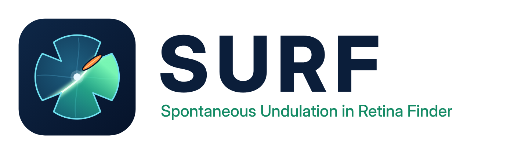

# SURF - Spontaneous Undulation in Retina Finder

Retinal wave calcium-imaging analysis.

Desktop app that replaces `Yonehara_video_rotator.ipynb`, the FIJI **Multi Measure** step and
`Yonehara_wave_analysis.ipynb`.

Rotation to anatomical coordinates, grid measurement, event detection, wavefront tracking (frequency,
speed, duration, direction), single-cell analysis with Suite2p / Cellpose and group statistics, in one
application for Windows and macOS.

* **Download:** the latest `SURF.zip` under [Releases](https://github.com/jerjely/SURF/releases).
* **Manual:** [`docs/SURF_user_manual.pdf`](docs/SURF_user_manual.pdf) (step by step, with screenshots).
* **Lab defaults:** [`defaults/surf_defaults.json`](defaults/surf_defaults.json) holds analysis presets for
  4×, 10× and 40× (stage II waves) and the objective calibration of our microscope. They are loaded on the
  first start, or with *Tools → Load lab defaults*. The calibration is only valid for our setup (1920 × 1080
  camera): calibrate your own objectives with *Tools → Calibration tool*.

## Installing

**Windows:** unzip, then double-click **`install_windows.bat`**. You don't need admin rights.
It finds Python 3.9+ (python.org or Anaconda), creates a private environment in
`%LOCALAPPDATA%\WaveAnalysis` (outside OneDrive), installs the packages and adds a
**SURF** shortcut to the Desktop and the Start menu. The first run takes a few minutes.
If you don't have Python yet, install it from python.org first and tick "Add python.exe to PATH".
`uninstall_windows.bat` removes the app, its environment and the shortcuts. Your data is not touched.
If Windows shows "Windows protected your PC", click *More info → Run anyway*. To avoid that, right-click the zip → Properties → *Unblock* before unzipping.

**macOS:** double-click **`install_mac.command`**. If macOS refuses, right-click → Open.
It creates **SURF** in `~/Applications`, which you can also find with Spotlight.

**Standalone version for PCs without Python** (e.g. a lab computer): after installing on your
own PC, run `install\build_standalone_windows.bat`. It produces `dist\SURF\` with
`SURF.exe` (~400–500 MB). Zip that folder and copy it to the other PC; there is nothing
to install there. Some antivirus programs are wary of self-built executables, so whitelist it if needed.

**Manual / developer:** `pip install -r requirements.txt`, then `python wave_gui.py [folder]`.

Updating: unzip the new version and run the installer again. Settings and results live next to
your videos, so they are kept.

If the app closes unexpectedly, the error is in `surf_error.log` in your user folder.
The Start menu also has a **SURF (console)** shortcut that shows messages while it runs.

## Workflow

| Tab | What it does | Writes |
|---|---|---|
| **1 Rotate** | Click temporal pole → nasal pole → centre on a frame (slider picks the time). Choose Right or Left retina. "Show rotated preview" checks the result. | `<video>rotation_calibPoints.pkl` (same format as the notebook), `<video>_wavegui.json` |
| **2 Measure** | Drag/resize the orange grid (or type x, y, square size, rows, cols; default = your FIJI grid 300, 66, 25 px, 50×40), **or** load the FIJI `*_ROI.zip`. Tick "Apply rotation on the fly" to measure the original MP4 in rotated coordinates, so you don't have to export a rotated copy. | `<video>_rotated_grid.npz` + `<video>_rotated_grid.csv` (FIJI Multi Measure format, so the old notebook still reads it) |
| **3 Events** | Gaussian smoothing + `find_peaks` per ROI (σ 5, prominence 1.5, distance 50, ignore first 10 s). Trace / raster / activity map / rate histogram. Click a square on the map to see its trace. | `…_grid/peaks_….csv`, `…_grid/rasters.npz` |
| **4 Waves** | Orientation (T/N/D/V clicks, pre-filled from the rotation), K-means wavefront centres, tracking, merging, directions, grid direction map, wave events. Optional movie. | `…_grid/…_wave_results.xlsx`, figures as png/eps/svg, `wave_movie.mp4` |

The file list shows the Sony `.THM` thumbnails (small JPEGs saved next to each `.MP4`). They hold
no imaging data. All settings are saved per video in `<video>_wavegui.json` and restored when you
select the video again. An existing measurement (`.npz`, or an old FIJI `.csv` via "Load
existing measurement") is picked up automatically.

## Tab 0 - Info

The Info tab has a fast **video player**. A low-resolution preview is decoded in the background the first time a video is shown, so dragging the slider and fast playback (up to 64×) are instant. When you stop, the exact full-resolution frame replaces the preview. Use Black / White / Gamma, **Auto once** or **auto (each frame)** for brightness, and choose colour, grey or a single channel (e.g. Green for GCaMP). Keys: Space play/pause, ←/→ one frame, Shift+←/→ 1 s, PgUp/PgDn 10 s, Home/End; type m:ss in *go to* to jump.

Before rotating, enter what the recording is: **Animal ID, Age, Condition**, treatment / dose,
genotype, sex, recording date (pre-filled from the file date), experimenter and notes. The same
tab sets the **objective, turret and eye** (mirrored on the Rotate tab). Everything is saved with
the video (`<video>_wavegui.json`), shown under the video's name in the list, and written into
the result workbook (summary sheet, `info.*` rows).

- **Copy info from another video…**, then click that video in the list. Notes are not copied.
- **Apply to other videos…** writes chosen fields (e.g. animal + age, objective, eye) to many
  videos at once.
- Drop-downs offer the values already used in this folder, so IDs stay consistent. Use exactly
  the same Animal ID for all videos of one animal: per-animal and paired statistics depend on it.

The **Compare** tab fills Animal / Age / Condition / Objective from this info. Edits made in
Compare are written back to the videos, and **Only objective** limits a comparison to one
objective.

## Orientation: dorsal up, left / right retina (never mirrored)

On the **Rotate** tab, click the temporal pole, the nasal pole and the centre, and choose
**Right retina** or **Left retina**. Viewed from the ganglion-cell side with dorsal up, a right
retina has nasal on the right and a left retina has nasal on the left. The video is only
rotated, never mirrored:

* right retina → nasal right, temporal left, dorsal up
* left retina → nasal left, temporal right, dorsal up

All directions are anatomical: **0° = towards temporal, 90° = towards dorsal, 180° = towards
nasal, 270° = towards ventral** (direction of travel). Polar plots are labelled T / D / N / V
and drawn to match the image of that retina: T on the left for a right retina, T on the right for
a left one. The group plots in the Compare tab use the right-retina layout (T left, N right, D up). If a video is measured without rotation, click temporal
and nasal on the Waves → Orientation view; the eye setting still gives dorsal/ventral.

Older calibrations (the notebook's rotation + mirror, and the short-lived "flip left retinas"
version) are converted automatically: same clicks, new orientation. Choose the eye and press Save calibration. Measurements made with the
old rotation still display and analyse correctly. Wave results from before this change used
angles relative to the nasal→temporal axis; the Compare tab marks them "old angles" and leaves
them out of the direction statistics until Waves is re-run.

## Reopening a video

Selecting a video you analysed before restores everything: rotation, scale, grid, the
measurement, the detected events (with the settings used) and the wave analysis with all plots.
The state is saved in the results folder (`events_state.npz`, `wave_state.pkl`). If you
re-measure the video, the old events and waves are not restored, because they belong to the
previous measurement.

**Copy calibration from another video** (Rotate tab) copies the rotation points and the mirror
setting in the same way: click the button, then click the source video.

**Copy grid from another video** (Measure tab): click the button, then click the source video in
the list on the left. Its grid (or ROI zip) is copied to the current video, and the current
video stays selected. You get a warning if one video was measured with rotation and the other
without.

## Scale (µm)

At the top of the **Rotate** tab, choose the **objective** and the **turret** setting. The first
time, click **Edit calibration…** and enter, for each objective, the full video height in µm at
turret 1× (e.g. film a stage micrometer). Other turret settings are computed as height ÷ turret
factor. You can add objectives and turret factors there. "Custom height" lets you type the
height for one video directly.

**Tools → Calibration tool** measures this for you. Open a calibration video or photo, choose
the objective and turret, and pause on a sharp frame. Click points around the rim of a structure
of known size (3 or more; a circle is fitted live, and the points can be dragged). Use **Line**
mode for two points across. **Add as REFERENCE** with the known diameter (e.g. 3000 µm) gives
µm/px at that setting. **Add as MEASUREMENT** gives the size in µm of another structure, e.g. the
small central circle, so it can serve as the ruler when the big circle no longer fits (**Use row
as known size**). Select a row to jump back to its frame and see what was marked (cyan). The
summary lists µm/px, video height and the real turret and objective factors. **Send to SURF
calibration** writes them into Edit calibration. The rows are saved next to the video as
`<video>_calib.json`. It also runs on its own: `python surf_calibrate.py [video]`.

The calibration is stored once per computer (`~/.wavegui_settings.json`). Each video remembers
its own objective and turret, and a new video starts with the last ones you used.

With a scale set, every length is in µm: the grid (left, top, square size; snapped to whole
pixels, with the px value in the tooltip), the distance parameters on the Waves tab, the plot
axes, and the Excel columns (`*_um`, speeds in `*_um_s`; pixel positions are kept as `*_px`).
The analysis itself still runs in pixels, so changing the scale never changes which waves are
found. The FIJI-format CSV stays in pixels, like FIJI's uncalibrated output.

## Analysis presets (objective / wave stage)

The Events and Waves tabs share a **preset** bar. A preset holds the event detection settings,
the wave tracking settings and optionally the grid square size. The analysed time window is
never part of a preset. Save one per objective and wave stage, e.g. "40x – stage II" or
"10x – stage III" (**Save current as…**).

**A preset must be applied to each video before Detect events / Run wave analysis.** The bar pre-selects the video's own preset, else the objective's default, else *Notebook defaults*; press **Apply**. You can still change individual settings afterwards. The bar then says *modified*, and the preset name (with "(modified)") is written into the result workbook. Videos analysed before presets existed keep their saved settings.

Distances (centre separation, link radius, merge distance, path lengths, grid square size) are
stored in **µm**, so a preset gives the same physical sizes on any objective or turret.
Tick **Default for this objective** (or use **More → Make selected the default…**) to apply a
preset automatically, grid size included, whenever you switch to that objective or open a new
video. On a video that is already measured, the grid is kept and only the settings change.
**More → Export / Import** shares presets with other computers. "Notebook defaults" restores
the original values.

**When one wave is split into several clusters at higher magnification:** a fixed px value
covers a smaller area at 40×. Keep the distances the same in µm as on the objective where the
tracking works (that's what presets do). Increase **Min centre separation** first: K-means keeps
adding centres while they are further apart than this. Then increase **Link radius** (the front
moves more px per frame) and **Merge: max distance**.

## Zooming the plots

Every plot (traces, maps, rasters, Compare figures) responds to the mouse directly:

| Where | Drag | Wheel | Right-drag |
|---|---|---|---|
| On the **y axis** (tick labels on the left) | pan up / down | zoom y | stretch / squeeze y |
| On the **x axis** (below the plot) | pan left / right | zoom x | stretch / squeeze x |
| **Inside** the plot | pan | zoom time (Shift = y, Ctrl = both; images: both) | zoom x and y |

**Double-click** restores the original view. The cursor changes to ↕ / ↔ over an axis. While
live preview redraws a trace, the zoom is kept as long as you stay on the same ROI. On the
activity map, a click still picks a square; a drag pans.

## Events tab: video view and live preview

The top of the Events tab shows the video with the ROI grid. Drag the slider to choose the
frame; squares active at that frame are red. Click a square to show its trace (a line marks the
current frame). Tick **Live preview on the selected ROI** and change σ, prominence, distance or
the ignore window: that ROI is re-detected immediately (magenta markers). **Detect events**
then applies the settings to all ROIs.

**Activity map colours** (Events tab → Activity map): colour map, min / max (events/min) or *auto
range* (2nd–98th percentile of the active squares), opacity, image behind on/off, and *hide squares
below min*. Squares are drawn at their real grid size; the choice is remembered.

**Exported figures for papers:** *Save results* (Waves tab) and *Export* (Compare tab) write every
figure as PNG (300 dpi), SVG, EPS and PDF at a fixed physical size (one panel about 8.4 cm wide) with
the same Arial sizes in all of them (tick labels 6 pt, axis labels and titles 7 pt). Text stays editable
text (no outlines), so place the files at 100 % in Illustrator and every panel has the same font size.

## Playback and the wave movie

Every video view has a play/pause button (or the space bar) and a speed menu (0.25×–16× real
time). At high speeds, frames are skipped if the PC can't decode fast enough.

**Waves → Movie** shows the original video. Play or scrub to where the movie should begin and
press **Set start here**, then do the same for **Set end here**. **Play interval** previews that
stretch. Tick **Show detected wave** to see the active squares (red) and wave centres (blue).
**Render movie…** then writes the overlay movie. It keeps the recording's fps; choose a
**speed** (or type one, e.g. 3) and faster speeds keep 1 of every n frames, slower ones play
every frame at a lower fps. **Time label** (upper left) shows the real video time, the time in
the rendered movie, or nothing. **Show speed** puts the speed in the upper-right corner.

## ΔF/F video (Info tab)

The **ΔF/F view** follows the deltaF_F prepare / viewer notebooks (Ackman 2012 macro).
**Compute F0** makes one pass through the video: F0 is the per-pixel temporal mean after
*Skip start*, with 2×2 spatial and 2-frame temporal binning, plus σ of ΔF/F. It is saved as
`<video>_F0.npz`. Then tick **Show ΔF/F in the player** and set black (−σ), white (+σ) and the
background mask (pixels whose F0 is below that percentile turn black); the ImageJ "16 colors"
table is used. **Render ΔF/F video…** writes the binned movie at the chosen speed.

## Tab 5 - Cells (single cells, e.g. 40×)

Needs the grid measurement (tab 2), because cells use the same frame space, rotation and grey
mode. Linking to waves needs the wave analysis (tab 4).

1. **Find cells**
   - **Suite2p** finds cells from activity; **Cellpose** finds them by shape on the mean / max /
     std image. Both run on a binned movie in which a soma is about 12 px.
   - **FIJI RoiSet.zip** imports your own ROIs, and **Only cells added by hand** starts empty.
   - Suite2p and Cellpose are optional. **Install Suite2p + Cellpose…** downloads them with
     PyTorch into SURF's environment (1-3 GB). On Windows SURF closes, the add-on installs in its own
     window (`install_cells_addon.bat` does the same) and SURF starts again; SURF's own OpenCV is kept. Cellpose downloads its model the first time it runs.
     The standalone .exe cannot install them.
2. **Review and edit ROIs**
   - The **cell list** shows number, use (accepted tick box), source, area, probability, events
     and participation. Click a row to select the cell and centre the view; Ctrl / Shift selects
     several rows.
   - On the image, click a cell to select it (Ctrl+click adds to the selection); double-click
     switches it between accepted (green) and rejected (red).
   - **Draw polygon**: click the corners; double-click or Enter closes the shape, Backspace removes
     the last corner, Esc cancels. *Add circle* places a circle of the cell diameter.
   - **Brightness** of the image (row above the click modes): *black* / *white* sliders (percentiles
     of the image, so they keep working when you switch mean / max / std / frame), *gamma*, *Auto*
     resets; *outlines* sets how opaque the cell outlines are.
   - **Brush** (like FIJI's selection brush; radius in µm next to it). Paint cell after cell:
     a left-drag that starts on **empty space paints a new cell**; one that starts **inside a cell adds
     to that cell**; **right-drag erases**. **Esc** / *New cell* lets go of the current cell; **N** / **P** step to the next / previous cell in the list and bring it into view (in any mode).
     Hold **Space** and drag to move the image (the wheel zooms). Untick *new cell from empty space*
     for FIJI's behaviour (starting outside the current cell erases from it). Erasing a whole cell deletes it.
   - **D** or **Delete** deletes the selected cell(s) (in any mode).
   - **Copy cells from another video…** (step 1): click it, then the source video in the list. Its cells
     are copied here, replacing or adding to the current ones; the shift between the two recordings is
     detected from the mean images and can be corrected or typed in. Videos with cells show a [cells] tag.
   - **Edit outline** turns the selected cell into a polygon with draggable corners (click a side
     to add a corner, right-click a corner to remove it); **Apply outline** or Enter.
   - **Delete selected** or the Delete key removes the selected cells.
   - You can also accept by Suite2p classifier probability and reject ROIs by size. Suite2p
     sometimes returns large patches of neuropil; reject those with **Reject larger than**.
3. **Traces, events and waves**
   - **Measure cell traces**: F = F_cell − r · F_neuropil, using a ring around each cell with
     other cells left out (r = 0.7 as in Suite2p, 0 = off).
   - **Detect events + link to waves**: the rule of the *Caimg spike detection - Wave* notebooks,
     in % of F0, where F0 = minimum of the raw trace in the baseline window and the trace is
     Gaussian-smoothed.
     - A peak must exceed the minimum of the next *drop window* by the threshold (notebook
       thresh / baselineCorr, e.g. 0.8 / 40 = 2 %).
     - Optionally it must also exceed the mean of ±window by the threshold.
     - It must be a local maximum over ± the set time.
     - It must be above the means of the short and long windows by ε.
     - Peaks closer than the merge time count as one event.
   - Choosing a rule in the menu applies it at once, and only the settings that rule uses are shown.
   - **Rule → Grid rule (tab 3 settings)** detects cell events with exactly the grid's peak rule: the
     Gaussian σ, prominence, minimum distance and start exclusion start from the Events tab values
     (blue = same as tab 3). They can be changed for the cells; changed values turn orange (tooltip shows
     the tab-3 value) and *Copy grid settings from tab 3* sets them back. *Grid rule prominence* 0 (default) converts the grey-level prominence
     to % ΔF/F at the typical grid-square brightness, so dim and bright cells are judged alike; 1 uses the
     grey levels directly on each cell's trace.
   - **Rule** also loads the one-cell or the 40× wave-notebook values. Cells dimmer than
     *Skip cells dimmer than* are not analysed (the notebook's cutoff).
   - Each event gets an amplitude and a 1/e decay time (find_spike_data). Use **Live preview** to
     tune the rule on the selected cell.
   - **Linking:** *time only* (as the notebook) puts an event in a wave when it falls in the
     wave's time window (long tracks of tab 4, ± padding). *Time + distance* also requires the wave
     centre to be within the link radius at that moment, so cells on the far side of the field are
     not counted.
   - **Participation** = waves a cell fired in ÷ waves that passed it. The chance level comes from
     the same event trains shifted randomly in time (200 shuffles, with a p value).
   - **Per wave:** cells recruited, latencies, and a *speed from cell timing*: regression of event
     time against position along the wave direction.
   - **Plots:** trace with waves and baseline shaded; raster in row-by-row order, with a shuffled
     order as a control; cell map coloured by any metric; histograms; recruitment per wave.

Results go into the recording's `…_wave_results.xlsx` (sheets `cells_single`, `cell_events`,
`cell_waves`, `cell_parameters`, and `cells.*` rows in the summary). In Compare, the cell
metrics appear as recording-level metrics, and **Data → Individual cells (violin)** shows every
cell. Running the wave analysis again rewrites the workbook: run *Detect events + link* again
afterwards. Cell settings can be stored in presets.

### Same waves? (co-participation)
After *Detect events + link to waves* (≥ 3 waves), the **Same waves?** plot tab asks whether the same
cells keep taking part in the same waves:
* **cell × cell** matrix: how often each pair joined the same wave, as z against chance (clustered, so
  groups of cells that travel together form red blocks). Chance = every wave recruits the same number
  of cells, drawn at random from the cells it reached (1000 shuffles). Pairs: BH-corrected q.
* **wave × wave**: Jaccard overlap of the recruited cells (do waves reuse the same cells?), mean vs chance, p.
* **distance**: neighbouring cells are naturally in the same waves (a wave covers an area);
  *z_vs_distance* compares each pair with pairs at a similar distance – > 3 = together more than the
  distance explains.
* **map** of the pairs that are together more than chance.
Sheets *cell_pairs*, *wave_similarity*, *copart_distance*; summary rows *cells.copart_…* and
*cells.wave_similarity_…* (usable in Compare).

### Cell movie (step 4)
**Render cell movie…** writes an MP4 of the recording (measured/rotated space, brightness and gamma
from the image sliders) with the analysed cells drawn on it:
* *cells flash at events*: a cell lights up at each detected event and fades over *flash* seconds –
  **orange = event linked to a wave, cyan = outside waves**; or *cells coloured by ΔF/F* (inferno).
* optional: the grid squares active at that moment (faint red), the wave centres (blue) and tracks
  (orange line); time and current wave number in the corner. Choose from/to (s) and speed.
* *follow brightness changes* (default on) re-adjusts the brightness during the movie, e.g. when the
  illumination changes; off = fixed from the first frame.
* Which grid tracks count as waves for the cells: *Waves = 0 long tracks* (tab 4 'Long track: > steps')
  or *1 all tracks* (also short wave patches – often better at 40×).

## Tab 6 - Compare recordings

1. **Add folder…** finds every analysed recording (`…_wave_results.xlsx`, written by the Waves
   tab) in a folder and its subfolders. Age is read from the folder name (e.g. "2026.06.18 - P10"
   → P10) and Animal defaults to the recording's folder.
2. Fill in **Condition** (yellow until set) and correct **Animal** / **Age** where needed:
   double-click a cell, or select several rows and use **Set … = … / Apply to selected**.
   *Recordings of the same retina/animal must share the same Animal name.* That is how the
   statistics know which videos are paired (control and drug of the same retina) and which
   are repeats.
3. **Save project…** stores the labels in a `.wavecompare.json` file, which is reopened
   automatically next time. Use **Reload results** after re-analysing a video.
4. Choose **Compare by** (Condition, Age or Animal), optionally restrict to one age or one
   condition, then **Compare groups**.

Statistics options:

* **Unit of analysis.** *Animal* (default) averages the recordings of each animal per group,
  so n = animals. *Recording* treats each video as independent, which is only valid with one
  video per animal; the app warns otherwise.
* **Pairing.** Auto-detect uses paired tests when the same animals appear in several groups.
* **Non-parametric:** Wilcoxon signed-rank (paired) or Mann-Whitney U, plus Friedman /
  Kruskal-Wallis for 3+ groups.
* **Parametric:** paired / Welch t-test, plus repeated-measures / one-way ANOVA.
* **Mixed model:** `metric ~ condition + (1 | animal)` on all recordings. It handles repeated
  videos and unbalanced designs; with few animals its p-values are optimistic.
* **Pairwise comparisons** are against the **reference group** (default Control), or all
  pairs, and Holm-corrected.
* **Directions:** per-recording mean direction of the wave segments. For each group, the
  circular mean, R and a Rayleigh test; between groups, a Watson-Williams test.

With few animals a rank test may be unable to reach p < 0.05 (e.g. Wilcoxon needs ≥ 6 pairs);
the Tests table says so in its notes. **Plot options:** choose the summary shown (box plot, median ± IQR, mean ± SEM, mean ± SD or
bars), whether to show the points and join the same animal, the **order** of the groups (drag in
the list or use ↑ / ↓) and a **colour** per group (double-click). These are saved with the
project and also used for the direction plots and the export. Ages sort naturally (P7, P10, P12).

**Export…** writes an Excel file (tests, group summary,
directions, the analysed values, labels, options) plus a figure per metric (png/svg/eps).

**Show in folder:** under the video list (right-click a video for its results folder), after
rendering a movie, and by right-clicking a row in the Compare table.

### Combined groups, Dunn's test and trend test

- **Combine groups**: in *Order / colour*, select several groups (Ctrl / Shift + click), press
  **Combine…** and name the group, e.g. P7 + P10 + P11 = "stage II", P14 + P18 = "stage III".
  The statistics then run on the combined groups. **Split** undoes one, and **use combined
  groups** switches between combined and original groups. Combined groups are saved with the
  project. With *Unit = animal*, an animal recorded at two ages in the same combined group counts
  once (its values are averaged).
- **Post-hoc**: for independent groups with the non-parametric test, choose **Dunn** (the
  standard follow-up to Kruskal-Wallis; it ranks all groups together, so small groups have more
  power) or a Mann-Whitney test for each pair. Pairwise p values are Holm-corrected; the plot
  brackets use the corrected p.
- **Trend test across groups**: one test for a steady increase / decrease along the group order,
  e.g. with age: Jonckheere-Terpstra (permutation p) plus Spearman. Levels come from the numbers
  in the group names (P7 → 7) when every group has one, else from the plot order, so reorder the
  list to define stage II < stage III < adult. The result is printed under the plot title and
  listed as "trend" in the Tests table. With small groups this is often the only test that can
  detect a developmental change: pairwise tests on n = 2-3 cannot reach significance after
  correcting for many comparisons.

### Individual waves (violin plots)

On the Plot tab, **Data → Individual waves (violin)** shows every wave of every recording instead of
one mean per recording: wave duration, path length, speed (path and start→end), travel distance
and inter-wave interval. These are the same long tracks the recording means are made of. Each
violin shows the distribution, ● the median, a bar for the IQR, faint dots for the waves and ◇
for the median of each recording. The group order, colours, combined groups, filters and bracket
setting are the same as for the recording means. The tests are listed in the Tests table with
level "individual waves" and exported (sheets `individual_waves`, `tests_individual_waves`,
figures `waves_*.png`).

**Statistics on waves:** waves from one recording are not independent, so Kruskal-Wallis / Dunn
or t-tests on all waves give p values that are far too small. Choose **Test → Mixed model** for a
valid wave-level test (random intercepts for recording and animal). The violins are best for
showing distributions; use the recording or animal level, or the mixed model, for the claim.

## Why the measurement is fast

The slow Python attempts usually loop over ROIs per frame. Here each frame costs a few
milliseconds and the video decoder is the bottleneck:

* frames are decoded in a background thread while the previous one is processed;
* rotation + mirror are folded into **one** `warpAffine` that renders only the grid's bounding box;
* grid: `cv2.resize(INTER_AREA)` with an integer factor gives the exact block mean of every square at once;
* arbitrary ROIs (ovals/polygons from a ROI zip) use one sparse-matrix product per frame.

The output was checked against a brute-force per-ROI mean (difference < 1e-4 grey levels) and
against the notebook's full-frame rotate-then-measure.

Grey value options: `(R+G+B)/3` (FIJI default, used for compatibility), weighted luminance, or
**green channel only**, which may give better SNR for GCaMP recorded on a colour camera.

## Workbook sheets (`…_wave_results.xlsx`)

`summary`, `tracks` (every final track: start/end time and position, duration, start→end length,
path length, angle), `begToEnd`, `travelDetails` (≈10 px segment angles and distances, as in the
notebook), `grid_vectors`, `wave_events`, `cells` (rate per ROI), `result` (same columns as the
old `_result.xlsx`), `parameters`.

Angles: 0° = wave travelling nasal → temporal, in image coordinates (y points down). Polar
plots use the notebook convention (0° at West, clockwise).

## Differences from the notebook (bugs fixed)

1. **Cell rate**: the notebook counted `len(peaks) - 1`, so every ROI was one event short. ROIs
   without events got a `[0, 0]` placeholder that also marked the *last* 40 frames of the raster
   (negative-index wrap). Now the rate uses the true count and there is no placeholder.
2. **1–3 active ROIs**: the notebook created *n* identical centroids, which gave duplicate tracks at
   the same spot. Now there is one centroid.
3. **New track IDs**: after a gap the notebook re-used the last ID, which could glue two different
   waves into one track. New tracks now always get a fresh ID.
4. **Linking** is one-to-one greedy nearest neighbour (≤ 50 px). The notebook took the closest
   match and then renumbered duplicates.
5. **Merging** joins chains A→B→C into one track. The notebook only merged pairs, so B could
   appear twice.
6. **Wave events**: the first track of the recording also counts as a wave start.
7. Peak time = frame index / fps (the notebook used (index + 1) / fps, a 20 ms shift).
8. The per-frame EPS snapshots and the seaborn movie loop (~1 h) are replaced by an optional cv2
   movie renderer (a few minutes).

Everything else, including parameters, raster windows (−40…+35 frames), the border/isolated-ROI
filter, the K-means cluster-number rule, merge/drop thresholds, smoothing, segments and grid
binning, follows the notebook. Every parameter is editable in the GUI.

## Using the core without the GUI

```python
import wave_core as wc
m = wc.measure_video("MAH09566.MP4", wc.RoiSet.from_grid(wc.GridSpec(300, 66, 25, 40, 50)),
                     rotation=wc.RotationCalib.load_pkl("MAH09566rotation_calibPoints.pkl"))
m.save_fiji_csv("MAH09566_rotated_grid.csv")
```

## Citation and licence

If you use SURF, please cite the paper it was published with (reference to be added) and this repository.
SURF is released under the MIT licence (see `LICENSE`). Suite2p and Cellpose, installed optionally, keep
their own licences.
